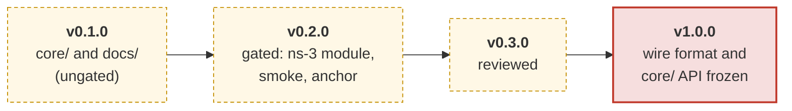
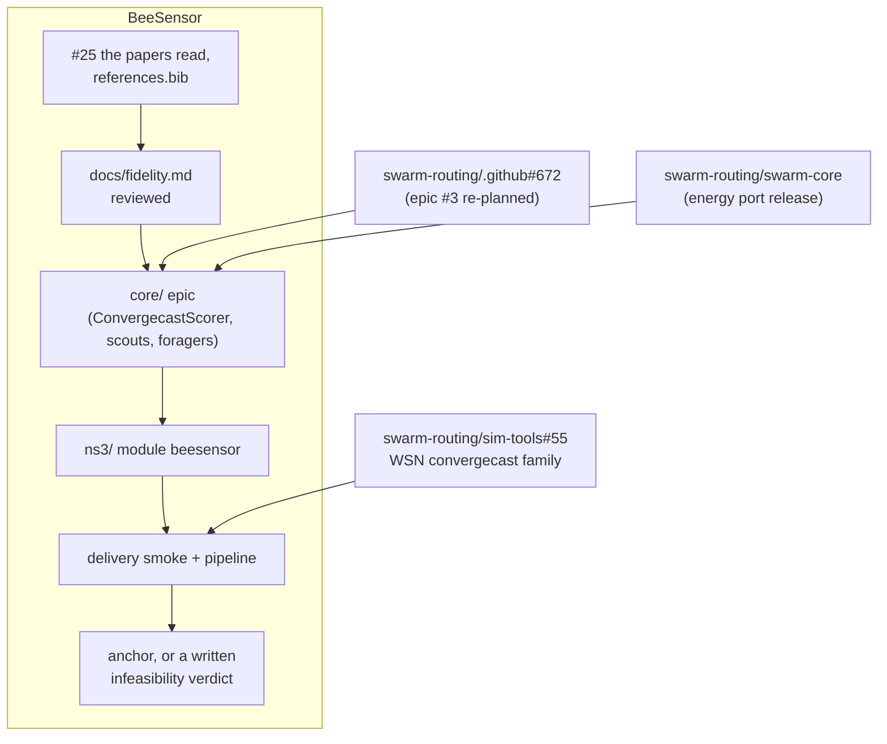

# Roadmap

BeeSensor's release ladder in one page. The shape is the org's (ROADMAP
"Releases"; AntHocNet's
[`docs/roadmap.md`](https://github.com/swarm-routing/AntHocNet/blob/main/docs/roadmap.md)),
as ARA, BeeAdHoc and HOPNET use it. The cross-repo release train is in the
[org ROADMAP](https://github.com/swarm-routing/.github/blob/main/ROADMAP.md).
Issue state is always truer than a checked-in diagram.

The ladder is **proposed**. Epic #3's deferral (decision 23 on
swarm-routing/.github#672) is lifted for setup and skeletons only
(swarm-routing/.github#881, 2026-11-24). The fidelity sheet and the first
`core/` are a v0 from public secondary sources, since the papers are closed
(the same issue, 2026-11-24). No release is scheduled, and no issue carries a
`release:` label yet. Releases are cut on
the maintainer's request only (CONTRIBUTING "Cutting a release").

## How this plan is tracked

Each issue a release gates carries one **`release:` label**, so every row
below is a live query once the labels exist:

| Release | Board |
|---|---|
| v0.1.0 | [`release:v0.1.0`](https://github.com/swarm-routing/BeeSensor/issues?q=is%3Aopen+label%3A%22release%3Av0.1.0%22) |
| v0.2.0 | [`release:v0.2.0`](https://github.com/swarm-routing/BeeSensor/issues?q=is%3Aopen+label%3A%22release%3Av0.2.0%22) |
| v0.3.0 | [`release:v0.3.0`](https://github.com/swarm-routing/BeeSensor/issues?q=is%3Aopen+label%3A%22release%3Av0.3.0%22) |
| v1.0.0 | [`release:v1.0.0`](https://github.com/swarm-routing/BeeSensor/issues?q=is%3Aopen+label%3A%22release%3Av1.0.0%22) |
| all epics | [`epic`](https://github.com/swarm-routing/BeeSensor/issues?q=is%3Aopen+label%3Aepic) |

Only issues a release actually gates are labelled; unscheduled work lands when
it lands. Majors are reserved for breaking changes, and 1.0.0 is the stability
promise.

## Release ladder

Amber is planned; nothing is shipped.

## What blocks what

## What each release must show to ship

| Release | Exit criteria |
|---|---|
| **v0.1.0** "ungated" | `docs/fidelity.md` reviewed by the maintainer, with [SUF12] as its primary version and every row cited, a repo choice or `unknown` (golden rule 10); the first `core/` slice (the CMake package `beesensor-core` on swarm-core's vcpkg port, with its tests, `core.yml` green); `docs/`. Released before the comparator gates: its release notes say no number from it counts as a benchmark result. |
| **v0.2.0** "gated" | The ns-3 module `beesensor` is green on `ns3-dev:latest-{debug,sanitized}`; the swarm-core router observer is adopted; the repository has its own benchmark pipeline on the org reusable cell workflow, with a paired delivery smoke on the WSN convergecast family (swarm-routing/sim-tools#55); the anchor reproducing [SUF12]'s own trend gives a verdict, PASS or a written infeasibility verdict (org golden rule 6); the `unknown` rows that `core/` and the anchor depend on are each a repo choice or a recorded decision. |
| **v0.3.0** "reviewed" | The fidelity sheet is re-checked against [SUF12] and [SF07] end to end; any new mechanism is default-off with its own A/B. |
| **v1.0.0** | Wire format and `core/` API frozen; a released run is recorded in the benchmarks global suite. |

## Infrastructure track

Rides along, is labelled by area, and never gates a release: CI hygiene, org
template refreshes (org-bot), settings as code, and the epic lists.

## Deliberate non-goals

- The sub-GHz duty-cycled low-power mesh stays ruled out
  (swarm-routing/AntHocNet#858); the scenario is the many-to-one WSN
  convergecast family.
- No Linux adapter here: the Linux host lives in swarm-routing/swarm-routingd
  and consumes `core/` by release (swarm-routing/.github#253).
- The papers' own curves are not reproduced as data; the anchor is a paired
  run, or a written infeasibility verdict.
- No 1.0.0 before v0.3.0 has been reviewed.

## See also

- [`fidelity.md`](fidelity.md): what the papers specify and where this
  implementation departs.
- Epic #3 and swarm-routing/.github#672: the plan and its decisions.
